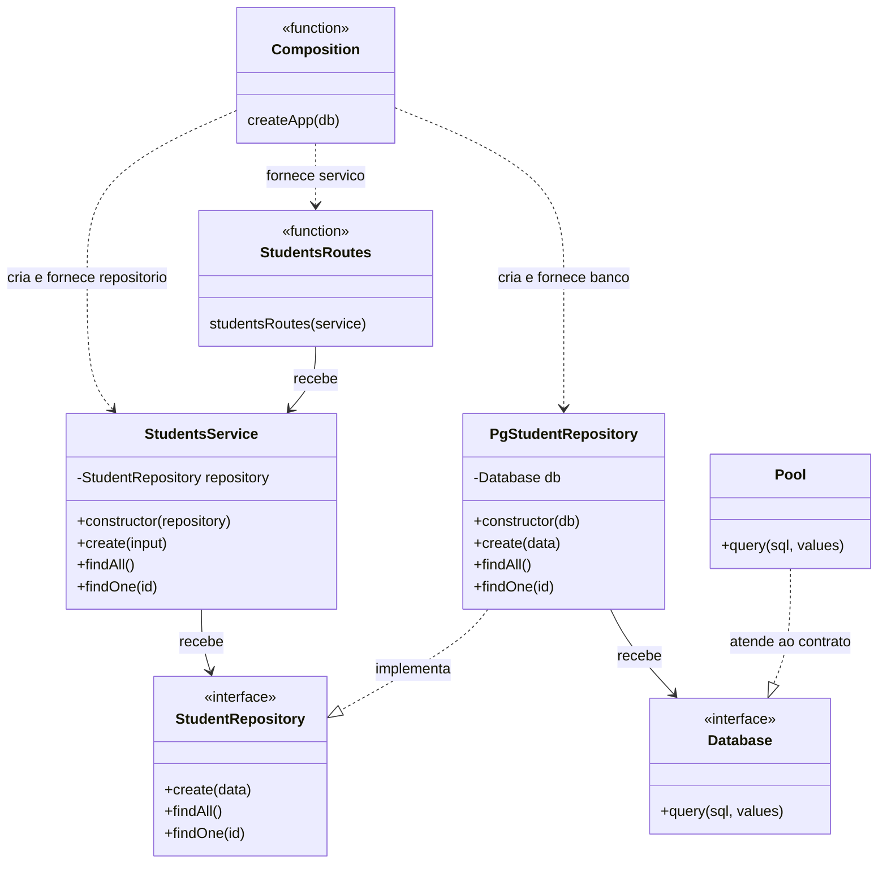
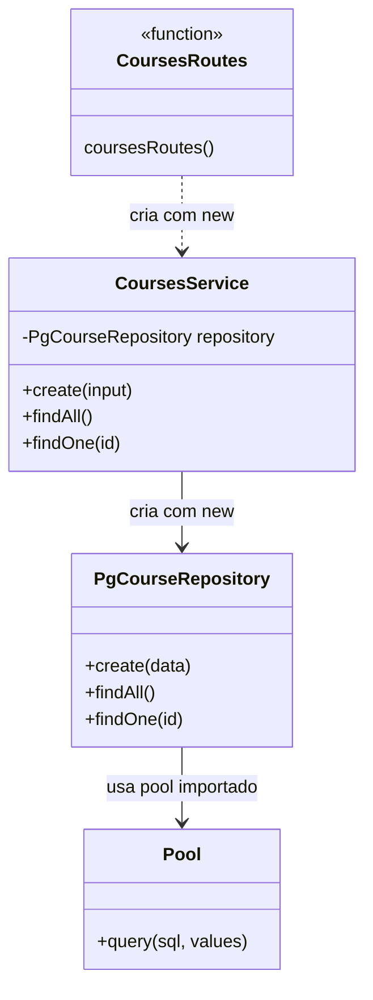
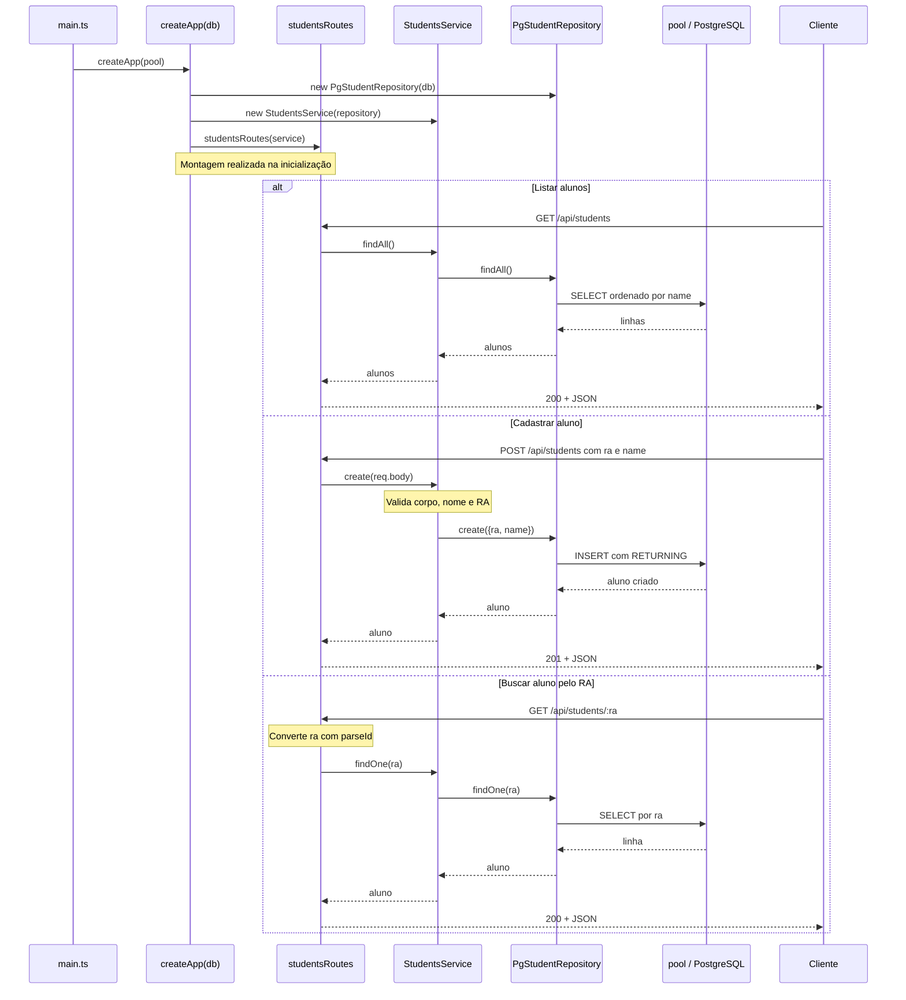
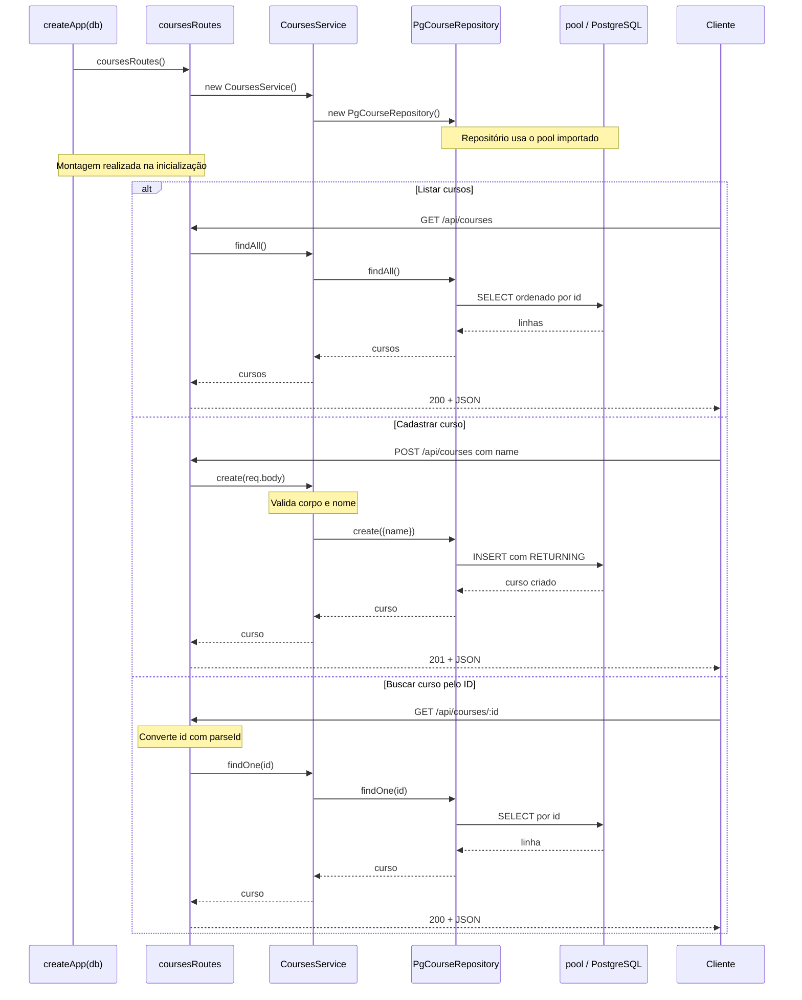

<div align="center">

# Atividade - Injeção de dependência

[Sobre](#sobre) - [Injeção de dependência](#o-que-é-injeção-de-dependência) - [Documentação](#documentação) - [Estado inicial do projeto](#estado-inicial-do-projeto) - [Estrutura](#estrutura-de-arquivos) - [Instruções](#instruções-para-execução)

</div>

<br>


## Sobre

Essa é um ativadade da disciplina de Desenvolvimento Web II, em que o objetivo foi adaptar o repositório do professor para fazer injeção de dependência em todas as rotas, e entender como tudo funciona.

Este projeto permite cadastrar alunos, cursos e matrículas por uma API Express com TypeScript e PostgreSQL. O objetivo da atividade é **implementar injeção de dependência nos módulos de cursos (`courses`) e matrículas (`enrollments`)**, usando o módulo de alunos (`students`) como referência.

<br>

## O que é injeção de dependência?

Uma **dependência** é um objeto de que outro objeto precisa para realizar seu trabalho. Neste projeto, o serviço precisa de um repositório para consultar e gravar dados; o repositório precisa de uma conexão com o banco.

**Injeção de dependência é fornecer essas dependências de fora, em vez de criá-las dentro de quem as utiliza.** O objeto continua usando a dependência, mas deixa a escolha e a criação dela para outra parte da aplicação.

### Quem monta os objetos?

Em [server/src/main.ts](server/src/main.ts), a aplicação recebe o `pool` com `createApp(pool)`. Para alunos, [server/src/app.ts](server/src/app.ts) monta a cadeia:

```ts
const studentRepository = new PgStudentRepository(db);
const studentsService = new StudentsService(studentRepository);
app.use("/api/students", studentsRoutes(studentsService));
```

O repositório recebe o banco, o serviço recebe o repositório e a função de rotas recebe o serviço. Esse local de montagem é chamado de **raiz de composição**. Usar `new` nesse local faz parte da solução: os objetos precisam ser criados, e a composição concentra essa responsabilidade.

A dependência é fornecida quando os objetos são montados. A cada requisição HTTP, as rotas usam os objetos já preparados; não precisam recriar essa cadeia.

<br>

## Estado inicial do projeto

| Camada | Alunos: exemplo com injeção | Cursos e matrículas: exercício |
| --- | --- | --- |
| Rotas | Recebem o serviço por parâmetro. | Criam o serviço com `new`. |
| Serviço | Recebe um repositório pelo contrato `StudentRepository`. | Cria o repositório concreto com `new`. |
| Repositório | Recebe o banco pelo contrato `Database`. | Importa e usa o `pool` diretamente. |
| Composição em `app.ts` | Conecta banco, repositório, serviço e rotas. | Chama as funções de rotas sem fornecer dependências. |

Essa diferença é intencional. Ao concluir a atividade, cursos e matrículas devem seguir o mesmo padrão de alunos.

<br>

## Documentação

### Diagramas de classes: estrutura atual

As funções de rotas e de composição aparecem como elementos com o estereótipo `function`; elas não são classes TypeScript.

#### Alunos: dependências recebidas de fora



O `Pool` da biblioteca `pg` atende à interface `Database` por compatibilidade estrutural do TypeScript: ele oferece a operação exigida. Não é necessário modificar a classe da biblioteca para declarar `implements Database`.

#### Cursos: dependências criadas internamente



O serviço de cursos conhece a classe concreta do repositório. O repositório usa diretamente o `pool` exportado por `connection.ts`. Matrículas apresenta a mesma organização inicial.

### Diagramas de sequência das rotas

Os exemplos abaixo mostram a montagem dos objetos e o caminho de sucesso de cada operação. As rotas convertem parâmetros de URL, os serviços validam os dados e aplicam regras, e os repositórios executam SQL parametrizado.

#### Alunos: montagem com injeção e requisições



#### Cursos: montagem interna e requisições



As chamadas HTTP percorrem camadas semelhantes nos dois módulos. A diferença está em **quem fornece as dependências** na inicialização. Após a refatoração de cursos, a montagem deve se parecer com a de alunos; os resultados HTTP devem continuar iguais.

Os diagramas omitem os caminhos de erro para facilitar a leitura. Entradas inválidas geram `400`, registros ausentes geram `404` e conflitos de unicidade geram `409`. Os erros seguem para o tratador de `app.ts`, que monta a resposta JSON.

<br>

## Instruções para execução

Com Docker e Docker Compose instalados, copie `.env.example` para `.env` se ainda não existir e execute na raiz:

```powershell
Copy-Item .env.example .env
docker compose up -d --build
```

Execute a cópia apenas se ainda não tiver `.env`, para preservar sua configuração. Com os valores do modelo:

| Recurso | Endereço |
| --- | --- |
| Interface web | http://localhost:8080 |
| API de alunos | http://localhost:3002/api/students |
| API de cursos | http://localhost:3002/api/courses |
| API de matrículas | http://localhost:3002/api/enrollments |
| PostgreSQL | `localhost:5433` |

O banco aplica `database/init.sql` e `database/seed.sql` na primeira inicialização de um diretório de dados vazio. Os dados persistem no volume `atv3_database_data`.

Para encerrar os serviços:

```powershell
docker compose down
```
